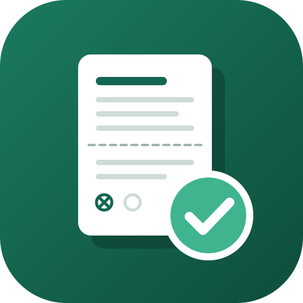
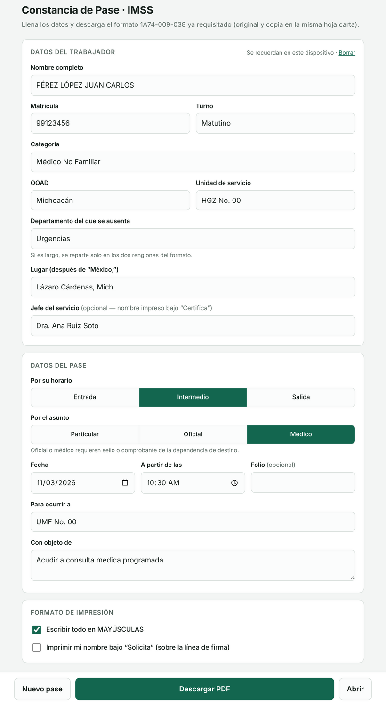
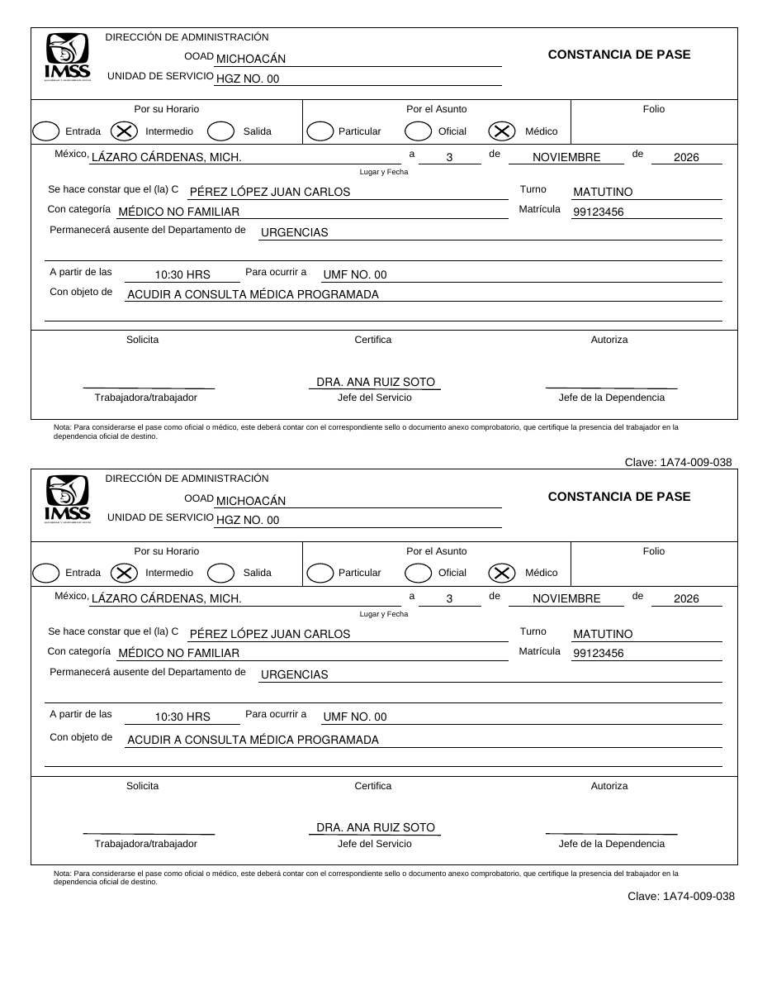

  

<h1 align="center">Pase IMSS</h1>

  Llena la <strong>Constancia de Pase</strong> del IMSS (formato 1A74-009-038) desde el celular o la computadora y descárgala en PDF, lista para imprimir y firmar.

  <a href="https://davmz86.github.io/pase-imss2026/"><strong>Abrir la aplicación →</strong></a>

---

Pase IMSS es una herramienta web gratuita y de uso libre para trabajadoras y trabajadores del Instituto Mexicano del Seguro Social. Escribe tus datos una sola vez, elige el tipo de pase y obtén el formato oficial ya requisitado, con original y copia en la misma hoja tamaño carta.

Es un proyecto independiente hecho por un trabajador del IMSS para sus compañeros. **No es una herramienta oficial del IMSS** ni está respaldada por el Instituto. El formato y su logotipo pertenecen al IMSS; esta aplicación solo escribe tus datos sobre él.

  
  &nbsp;&nbsp;
  

Formulario y PDF resultante. Los datos mostrados son ficticios.

## Cómo usarlo

1. Abre **[davmz86.github.io/pase-imss2026](https://davmz86.github.io/pase-imss2026/)** en cualquier navegador.
2. Llena **Datos del trabajador**: nombre, matrícula, turno, categoría, OOAD, unidad, departamento y lugar. Solo la primera vez; se recuerdan para los siguientes pases.
3. En **Datos del pase** elige el tipo por horario (entrada, intermedio o salida) y por asunto (particular, oficial o médico), la fecha, la hora, el destino y el motivo.
4. Pulsa **Descargar PDF** o **Abrir** para imprimirlo directamente.
5. Imprime en hoja carta, recorta por la mitad y recaba las firmas autógrafas de quien solicita, certifica y autoriza.

Para el siguiente pase pulsa **Nuevo pase**: se limpian destino, motivo y folio, y tus datos personales se conservan.

### Al imprimir

- Usa hoja **carta** y escala **100 % / tamaño real**. La opción "ajustar a la página" puede desalinear el texto respecto a los renglones.
- Los pases por asunto **oficial** o **médico** deben llevar el sello o comprobante de la dependencia de destino, como indica la nota del propio formato.
- La aplicación no sustituye las firmas ni la autorización de tu jefe inmediato. Verifica con tu área de personal que el formato impreso se acepte en tu unidad.

## Tus datos y privacidad

Todo ocurre dentro de tu navegador. La aplicación **no tiene servidor, no envía tus datos a ningún lado y no usa cuentas ni rastreadores**. El PDF se genera en tu propio dispositivo.

Tus datos de trabajador se guardan solo en el almacenamiento local del navegador (`localStorage`) para no tener que escribirlos cada vez. Si usas una computadora compartida, pulsa **Borrar** junto a "Datos del trabajador" al terminar.

## Uso sin internet

`index.html` es un solo archivo que ya incluye la plantilla del formato y la biblioteca para generar el PDF. Puedes descargarlo (botón **Code → Download ZIP**, o guardando la página) y abrirlo con doble clic en cualquier computadora, sin conexión.

## Problemas y sugerencias

El acomodo del texto está calibrado sobre la plantilla del formato 1A74-009-038. Si algo sale encimado, cortado o fuera de su renglón, [abre un reporte](https://github.com/DaVmZ86/pase-imss2026/issues) e incluye:

- El navegador y dispositivo que usaste (por ejemplo, Chrome en Android o Safari en iPhone).
- Qué campo se ve mal y una captura del PDF.
- Si usaste mayúsculas automáticas y si imprimiste a tamaño real.

**Antes de subir una captura, borra o cubre tu nombre, matrícula y cualquier otro dato personal.** No publiques pases reales.

Limitaciones conocidas: los textos muy largos se reducen de tamaño para caber en su renglón, y los caracteres que la fuente del PDF no admite (algunos símbolos o emojis) se sustituyen por `?`.

## Desarrollo y contribuciones

No hay instalación ni dependencias: todo vive en `index.html`.

- **Estilos y formulario**: bloque `<style>` y el HTML del formulario.
- **Llenado del PDF**: función `fillPase()`. Las coordenadas están en puntos PDF medidas desde el borde superior de la hoja carta (612 × 792). La copia inferior está desplazada 350 pt hasta "Para ocurrir a" y 353 pt desde "Con objeto de".
- **Plantilla**: el PDF original va embebido en Base64 en la constante `TPL_B64`.

Para probar cambios, abre `index.html` localmente, genera un PDF con datos ficticios y compáralo impreso contra el formato en papel. Mantén los cambios acotados y distingue en tu propuesta qué revisaste en pantalla y qué comprobaste en una impresión real.

## Créditos y licencia

Creado por **Dr. Humberto David Merino Zárate**, médico de urgencias del IMSS.

El PDF se genera con [pdf-lib](https://github.com/Hopding/pdf-lib) (licencia MIT, © Andrew Dillon), incluida dentro de `index.html`; su aviso de licencia está en [LICENSE](LICENSE).

El código de esta aplicación se publica bajo la licencia MIT; consulta [LICENSE](LICENSE). El formato "Constancia de Pase" (clave 1A74-009-038), su diseño y el logotipo del IMSS son propiedad del Instituto Mexicano del Seguro Social y no forman parte de esa licencia.
